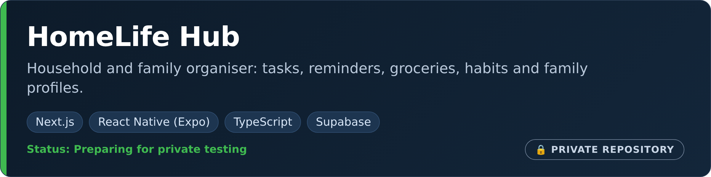
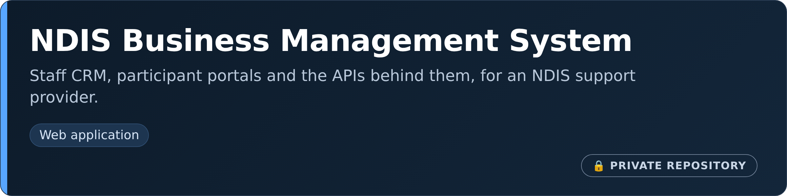
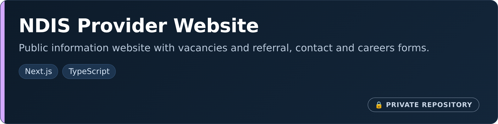

# Naresh Adhikari

**IT professional in Sydney who builds real applications, business systems and open-source tools.** More than five years in technical support, end-user computing and IT operations across Microsoft 365, Azure, networking and Windows environments, alongside hands-on development of web and mobile applications, websites, command-line tools and Nepali-language data tooling.

[Personal site](https://nareshadhikari.com.au) · [LinkedIn](https://www.linkedin.com/in/iamnarace/) · [1Touch IT](https://www.1touchit.com.au/)

## Featured products

Larger systems I have designed and built. Their source code is private, so there are no repository links; the cards show what each one is.

- **What it is:** a mobile-first household and family dashboard for tasks, reminders, habits, cleaning, laundry, plant care, bin reminders, groceries, family profiles and simple automations.
- **Built with:** a Next.js and React web app (installable as a PWA) and an Expo / React Native mobile app for iOS and Android, TypeScript, Tailwind CSS and Supabase, with Vitest and Playwright tests.
- **My role:** product design and development.
- **Status:** preparing for private testing. Product site: [homelifehub.com.au](https://homelifehub.com.au).

- **What it is:** a business management system for an NDIS support provider: a staff CRM, participant portals and the APIs behind them.
- Implementation details and source code are private.

- **What it is:** the public website for an NDIS support provider, with organisation information, vacancies, and referral, contact, complaint and careers forms that connect to the CRM's public endpoints.
- **Built with:** Next.js and TypeScript. The website is deliberately separate from the CRM and holds no secrets or database access.
- **My role:** development.

## Open-source projects

Public repositories you can read, run and test. Most are recent and deliberately small; each README states its status, how to run it and its known limitations. Current focus: Nepali-language tooling, privacy-first browser tools and developer utilities.

<table>
<tr>
<td valign="top" width="50%">
 
<b><a href="https://github.com/iamnarace/nepali-eval">nepali-eval</a></b> Python 
Evaluation harness for Nepali-language AI output. Scores answers the way a Nepali reader would accept them (<code>१०</code> = <code>10</code>), keeps spelling variants as separate references, and has a native-speaker review workflow.
</td>
<td valign="top" width="50%">
 
<b><a href="https://github.com/iamnarace/nepali-data-commons">nepali-data-commons</a></b> Python 
Contribution, review and export workflow for Nepali text data: checks Devanagari quality, flags personal data and duplicates, requires a second reviewer, and publishes a dataset card.
</td>
</tr>
<tr>
<td valign="top" width="50%">
 
<b><a href="https://github.com/iamnarace/robotspec">robotspec</a></b> Python 
Tests a <code>robots.txt</code> like code: RFC 9309 matching, a crawler access matrix (including AI crawlers) and policy checks that run in CI.
</td>
<td valign="top" width="50%">
 
<b><a href="https://github.com/iamnarace/devdesk">devdesk</a></b> TypeScript, React 
Offline developer utility workbench: JSON, diff, Base64, URL, UUID and timestamps, with no external network requests.
</td>
</tr>
<tr>
<td valign="top" width="50%">
 
<b><a href="https://github.com/iamnarace/fairhour">fairhour</a></b> JavaScript, no dependencies 
Plans a recurring meeting across time zones so nobody always takes the 6 am call, with daylight-saving-aware scoring and <code>.ics</code> export.
</td>
<td valign="top" width="50%">
 
<b><a href="https://github.com/iamnarace/paperflow">paperflow</a></b> TypeScript, React, pdf-lib 
Merge, split, reorder and clean PDF metadata entirely in the browser; files never leave the device.
</td>
</tr>
</table>

Also: [nepali-resource-audit](https://github.com/iamnarace/nepali-resource-audit) (overlap and licence audit for community dataset lists) and [penny-split](https://github.com/iamnarace/penny-split) (split an itemised receipt to the exact cent).

## Technology

- **IT operations:** Microsoft 365, Azure, Active Directory, networking, Windows, end-user computing
- **Development:** Python, TypeScript, JavaScript, React, Next.js, React Native (Expo), Node.js, Supabase, HTML/CSS
- **Engineering practice:** pytest, Vitest, Playwright, GitHub Actions, code review through pull requests

## Experience and certifications

- **IT support and operations (2020 to present):** technical support technician, onsite desktop engineer, end-user computing field engineer and IT support officer across Windows, macOS, Android and iOS, Active Directory, Microsoft 365, Azure, VPN and backup.
- **1Touch IT:** a venture providing IT support and practical technology solutions for homes and small businesses in Greater Sydney.
- **Education:** Bachelor of Information Technology, Victoria University (Sydney).
- **Certifications:** CCNA · Azure Administrator Associate · Microsoft 365 Fundamentals · AWS Cloud Practitioner · ITIL Foundation

## Connect

[Personal site](https://nareshadhikari.com.au) · [LinkedIn](https://www.linkedin.com/in/iamnarace/) · [1Touch IT](https://www.1touchit.com.au/)
