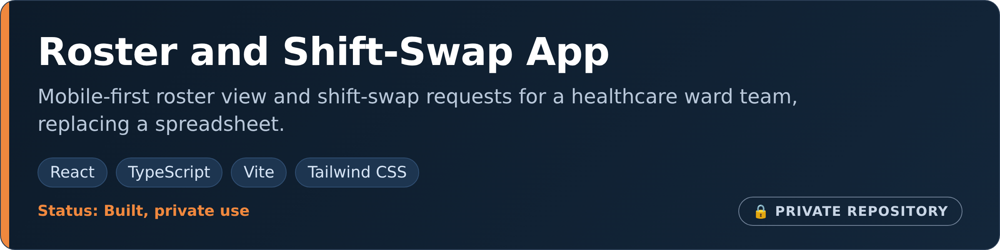
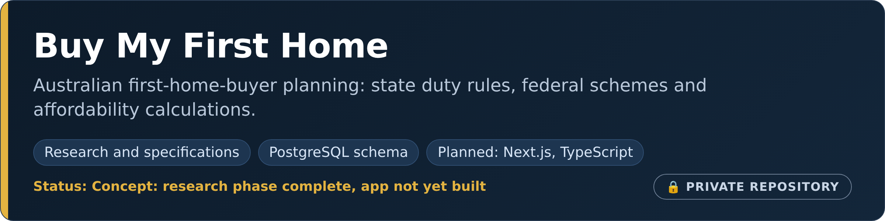

# Naresh Adhikari

**IT professional in Sydney who builds real applications, business systems and open-source tools.** More than five years in technical support, end-user computing and IT operations across Microsoft 365, Azure, networking and Windows environments, alongside hands-on development of web and mobile applications, websites, command-line tools and Nepali-language data tooling.

[Personal site](https://nareshadhikari.com.au) · [LinkedIn](https://www.linkedin.com/in/iamnarace/) · [1Touch IT](https://www.1touchit.com.au/)

**At a glance:** 19 projects below: 12 public repositories with source you can read, 5 private products and systems shown as cards (no links), and 2 websites.

## Products and applications

Products I have designed and built. Private repositories are labelled and not linked; each card shows only what the project is.

- **What it is:** a mobile-first household and family dashboard for tasks, reminders, habits, cleaning, laundry, plant care, bin reminders, groceries, family profiles and simple automations.
- **One product, several parts:** a Next.js and React web app (installable as a PWA), an Expo / React Native mobile app for iOS and Android with offline-first tasks, a marketing website and a design lab of planning documents and prototypes.
- **Built with:** TypeScript, Tailwind CSS and Supabase, with Vitest and Playwright tests.
- **My role:** product design and development.
- **Status:** preparing for private testing. Product site: [homelifehub.com.au](https://homelifehub.com.au).

- **What it is:** turns a cluttered roster spreadsheet into a mobile-first calendar of upcoming shifts, with shift-swap requests.
- **Built with:** React, TypeScript, Vite and Tailwind CSS.
- **Status:** built for private use.

- **What it is:** a planned Australian home-buying planning platform connecting affordability calculations, state and territory duty rules, federal schemes and a step-by-step buying roadmap.
- **Where it is:** concept. Milestone 1 (research) is complete: product requirements, a source register, calculation specifications, rules for all eight states and territories, a database schema and a data-validation script. The web application has not been built yet.

## Business systems and platforms

- **What it is:** a business management system for an NDIS support provider: a staff CRM, participant portals and the APIs behind them.
- **Built with:** Next.js, TypeScript, Supabase (PostgreSQL) and Playwright tests.
- Implementation details and source code are private.

- **What it is:** the public website for an NDIS support provider, with organisation information, vacancies, and referral, contact, complaint and careers forms that connect to the CRM's public endpoints.
- **Built with:** Next.js and TypeScript. Deliberately separate from the CRM, with no secrets or database access.
- **My role:** development.

## Nepali language, research and data

Open-source tooling for Nepali-language AI evaluation, community datasets and resource quality.

<table>
<tr>
<td valign="top" width="50%">
 
<b><a href="https://github.com/iamnarace/nepali-eval">nepali-eval</a></b> Python 
Evaluation harness for Nepali-language AI output. Scores answers the way a Nepali reader would accept them (<code>१०</code> = <code>10</code>), keeps spelling variants as separate references, and has a native-speaker review workflow.
</td>
<td valign="top" width="50%">
 
<b><a href="https://github.com/iamnarace/nepali-data-commons">nepali-data-commons</a></b> Python 
Contribution, review and export workflow for Nepali text data: checks Devanagari quality, flags personal data and duplicates, requires a second reviewer, and publishes a dataset card.
</td>
</tr>
<tr>
<td valign="top" width="50%">
 
<b><a href="https://github.com/iamnarace/nepali-resource-audit">nepali-resource-audit</a></b> Python 
Overlap and licence audit for community Nepali dataset lists, with safe link checking and a generated static report site.
</td>
</tr>
</table>

## Developer tools and utilities

Small, focused tools. Each README states its status, how to run it and its known limitations.

<table>
<tr>
<td valign="top" width="50%">
 
<b><a href="https://github.com/iamnarace/robotspec">robotspec</a></b> Python 
Tests a <code>robots.txt</code> like code: RFC 9309 matching, a crawler access matrix (including AI crawlers) and policy checks that run in CI.
</td>
<td valign="top" width="50%">
 
<b><a href="https://github.com/iamnarace/devdesk">devdesk</a></b> TypeScript, React 
Offline developer utility workbench: JSON, diff, Base64, URL, UUID and timestamps, with no external network requests.
</td>
</tr>
<tr>
<td valign="top" width="50%">
 
<b><a href="https://github.com/iamnarace/fairhour">fairhour</a></b> JavaScript, no dependencies 
Plans a recurring meeting across time zones so nobody always takes the 6 am call, with daylight-saving-aware scoring and <code>.ics</code> export.
</td>
<td valign="top" width="50%">
 
<b><a href="https://github.com/iamnarace/paperflow">paperflow</a></b> TypeScript, React, pdf-lib 
Merge, split, reorder and clean PDF metadata entirely in the browser; files never leave the device.
</td>
</tr>
<tr>
<td valign="top" width="50%">
 
<b><a href="https://github.com/iamnarace/pixelpalette">pixelpalette</a></b> TypeScript, React 
Colour workbench for designers and front-end engineers: palette generation, WCAG 2.1 contrast checks and HEX, RGB and HSL conversion.
</td>
<td valign="top" width="50%">
 
<b><a href="https://github.com/iamnarace/penny-split">penny-split</a></b> TypeScript, React 
Splits an itemised receipt to the exact cent: shared dishes, uneven portions, tax, tip and discounts, with every share adding up to the total.
</td>
</tr>
</table>

## Browser apps

Local-first, in-browser apps built with React, TypeScript, Vite and Tailwind CSS, with Vitest tests and CI.

<table>
<tr>
<td valign="top" width="50%">
 
<b><a href="https://github.com/iamnarace/spendwise">spendwise</a></b> TypeScript, React 
Privacy-friendly personal expense and monthly budget tracker.
</td>
<td valign="top" width="50%">
 
<b><a href="https://github.com/iamnarace/ecotrack">ecotrack</a></b> TypeScript, React 
Educational simulator for household and commuter carbon footprint scenarios.
</td>
</tr>
<tr>
<td valign="top" width="50%">
 
<b><a href="https://github.com/iamnarace/focusgarden">focusgarden</a></b> TypeScript, React 
Focus timer and daily habit tracker with a botanical growth companion.
</td>
</tr>
</table>

## Websites

- **[1Touch IT](https://www.1touchit.com.au/)** (live): website for an IT support venture serving homes and small businesses in Greater Sydney. Static site; [source on GitHub](https://github.com/iamnarace/WebsiteN).
- **[Personal portfolio](https://nareshadhikari.com.au)** (live): HTML, CSS and JavaScript portfolio. Private repository.

## New projects and in progress

- **Buy My First Home**: concept in the research phase (see Products above).
- **HomeLife Hub**: web and mobile apps preparing for private testing.

## Technology

- **IT operations:** Microsoft 365, Azure, Active Directory, networking, Windows, end-user computing
- **Development:** Python, TypeScript, JavaScript, React, Next.js, React Native (Expo), Node.js, Supabase, HTML/CSS
- **Engineering practice:** pytest, Vitest, Playwright, GitHub Actions, code review through pull requests

## Experience and certifications

- **IT support and operations (2020 to present):** technical support technician, onsite desktop engineer, end-user computing field engineer and IT support officer across Windows, macOS, Android and iOS, Active Directory, Microsoft 365, Azure, VPN and backup.
- **1Touch IT:** a venture providing IT support and practical technology solutions for homes and small businesses in Greater Sydney.
- **Education:** Bachelor of Information Technology, Victoria University (Sydney).
- **Certifications:** CCNA · Azure Administrator Associate · Microsoft 365 Fundamentals · AWS Cloud Practitioner · ITIL Foundation

## Connect

[Personal site](https://nareshadhikari.com.au) · [LinkedIn](https://www.linkedin.com/in/iamnarace/) · [1Touch IT](https://www.1touchit.com.au/)
